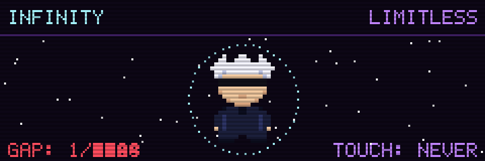

<!-- ═══════════════════════  HOLLOW PURPLE  ═══════════════════════ -->
<p align="center">
  
</p>

<p align="center">
  
</p>

<p align="center">
  
  
</p>

---

## 🎓 Sorcerer Profile

<table>
<tr>
<td valign="middle" width="55%">

I'm **Priyam Ghosh**, a student at **IIT (ISM) Dhanbad** and a deep enthusiast of **Machine Learning**, especially its **research** side. That's the field I want to keep going in.

The idea that pulls me in: the **simple, often-overlooked ways humans learn** can guide how we improve our models.

Mathematics is my strong point. I like to understand *why* something works, with proof and intuition, not just *that* it works.

</td>
<td valign="middle" align="center" width="45%">
  
</td>
</tr>
</table>

---

## 🌀 Domain Expansion

The idea above, written as Bayes' rule:

```math
\underbrace{p(\theta \mid \mathcal{D})}_{\text{what the model becomes}}
\;\propto\;
\underbrace{p(\mathcal{D} \mid \theta)}_{\text{what the data says}}
\;\cdot\;
\underbrace{p(\theta)}_{\text{how humans learn}}
```

---

## ♾️ Infinity

<p align="center">
  
</p>

<details>
<summary><b>The mathematics of Infinity: convergence, measure, geometry, topology</b></summary>

<br>

> Following Achmad Roykhan Sabiq, *Mathematics Behind Jujutsu Kaisen: Gojo Satoru's Infinity* (Oxford University Mathematics Essay Competition, 2026).

#### 1. Convergence: halving alone is no defence

Gojo describes Infinity as endless halving: the attacker must cross half the gap, then half of what remains, forever. With the gap normalised to 1, the attacker passes the points $`z_n = 1 - 2^{-n}`$, and the distance covered after $`n`$ halvings is

```math
S_n = \sum_{k=1}^{n} \frac{1}{2^k},
\qquad
S_n - \frac{1}{2} S_n = \frac{1}{2} - \frac{1}{2^{n+1}}
\quad\Longrightarrow\quad
S_n = 1 - \frac{1}{2^n} \to 1 .
```

At constant speed the crossing times form the same geometric series, so the total time is finite too. That resolves Zeno's paradox, and it also means subdivision alone stops nothing: infinitely many steps, finite distance, finite time.

#### 2. Measure: the barrier takes up no space

The set of halving points $`Z = \{z_1, z_2, \dots\}`$ has Lebesgue measure zero. For any $`\varepsilon > 0`$, cover each $`z_n`$ by an open interval of length $`\varepsilon / 2^n`$:

```math
I_n = \left( z_n - \frac{\varepsilon}{2^{n+1}},\; z_n + \frac{\varepsilon}{2^{n+1}} \right),
\qquad
m^*(Z) \le \sum_{n=1}^{\infty} |I_n| = \sum_{n=1}^{\infty} \frac{\varepsilon}{2^n} = \varepsilon .
```

Since $`\varepsilon`$ is arbitrary, $`m(Z) = 0`$. Infinitely many points, zero total length: whatever stops the attack, it is not the points.

#### 3. Geometry: Infinity changes the ruler

In a 2021 collaboration with RIKEN researchers (Jump GIGA, *Jujutsu Kaisen Abyss of Math Course*), Infinity is modelled not as subdivision but as a change of **metric**, the rule that turns a step $`dx`$ into a felt distance $`ds`$:

```math
ds^2 = \sum_{i,j} g_{ij}\, dx_i\, dx_j ,
\qquad
K(x, y) = \exp\left( -\frac{\|x - y\|^2}{\sigma^2} \right).
```

The metric is built from the Gaussian kernel $`K`$, the same RBF kernel used to measure similarity in machine learning. Far from Gojo, $`ds \approx dx`$. Near him the metric blows up, and every step feels longer.

A one-dimensional picture shows why that stops the attack. *(This example is my illustration, not the RIKEN formula.)* Let $`r`$ be the gap to Gojo and let the felt distance be $`ds = \Omega(r)\,|dr|`$ with $`\Omega(r) = c/r`$. Then the felt distance to Gojo is infinite:

```math
\int_{\varepsilon}^{r_0} \frac{c}{r}\, dr = c \ln\frac{r_0}{\varepsilon} \to \infty
\quad \text{as } \varepsilon \to 0 .
```

An attacker moving at constant felt speed $`v`$ obeys

```math
v = \Omega(r)\,|\dot r| = \frac{c\,|\dot r|}{r}
\quad\Longrightarrow\quad
r(t) = r_0\, e^{-vt/c} > 0 \quad \text{for all } t .
```

Every halving takes the same time $`c \ln 2 / v`$, so the halvings never finish. That is the steady beat of the GAP counter in the animation above.

#### 4. Topology: how Sukuna got through

The defence depends on $`\Omega`$ being continuous across the space between the attacker and Gojo. Mahoraga's adaptation, and then Sukuna's World Cutting Slash, aimed at the space itself instead of the points in it. A cut that breaks the continuity of space does not need to cross any distance. Infinity was not penetrated; the space carrying it was severed.

</details>

---

## 💫 Tech Stack

<p align="center">
  
</p>

---

## 🔥 Cursed Energy Output

<p align="center">
  
  
</p>

<p align="center">
  
</p>

---

## 🐺 Ten Shadows: summon me

<!-- ✏️ Replace every YOUR_… placeholder with your real handle/link. Delete any badge you don't use. -->
<p align="center">
  <a href="https://www.linkedin.com/in/YOUR_LINKEDIN"></a>
  <a href="https://x.com/YOUR_X_HANDLE"></a>
  <a href="https://www.kaggle.com/YOUR_KAGGLE"></a>
  <a href="mailto:YOUR_EMAIL"></a>
</p>

---

<p align="center">
  <i>"Throughout heaven and earth, the gradient alone points the way."</i><br>
  <sub>with apologies to Gojo Satoru</sub>
</p>
