<!-- ═══════════════════════  DOMAIN EXPANSION  ═══════════════════════ -->
<p align="center">
  
</p>

<p align="center">
  <a href="https://github.com/Priyam-Ghosh-06">
    
  </a>
</p>

<p align="center">
  
  
  
</p>

---

## 🎓 Jujutsu High — Student File

<table>
<tr>
<td valign="top" width="60%">

```yaml
sorcerer:          Priyam Ghosh
school:            IIT (ISM) Dhanbad      # Jujutsu High, Dhanbad campus
program:           B.Tech, <your branch>  # ✏️ edit me
grade:             Grade 2 → Special Grade
cursed_energy:     mathematics            # the source of every technique
innate_technique:  >
  Studying the simple, overlooked ways humans learn —
  and turning them into better learning algorithms.
binding_vow:       "No code until the math has no loopholes."
status:            training...            # always
```

</td>
<td valign="top" width="40%">

**Who I am, without the curses.**<br>
I'm an ML research enthusiast. Children don't learn from shuffled
i.i.d. mini-batches. They learn easy things before hard ones, they forget and relearn,
they sleep on it, they ask *why*. I think many of the next good ideas in ML are hiding
in those everyday facts about learning. I like proofs more than leaderboards.

</td>
</tr>
</table>

---

## 🌀 Domain Expansion — the research objective

Inside a domain, every technique is a guaranteed hit. Mine is a single equation:

```math
\underbrace{p(\theta \mid \mathcal{D})}_{\text{what the model becomes}}
\;\propto\;
\underbrace{p(\mathcal{D} \mid \theta)}_{\text{what the data says}}
\;\cdot\;
\underbrace{p(\theta)}_{\text{how humans learn}}
```

Most of ML's progress comes from scaling the **likelihood** (more data, bigger models).
My domain is the **prior**: the inductive biases we can borrow from human learning.

---

## 🩸 Cursed Technique Catalogue

| Technique | In the Jujutsu world | In my research |
|---|---|---|
| ♾️ **Limitless: Infinity** | Gojo's Infinity is a convergent series. You get closer forever and never arrive. | **Convergence theory.** When does $`\sum_t \eta_t \nabla\mathcal{L}(\theta_t)`$ actually reach a minimum, and how fast? |
| ➕ **Reverse Cursed Technique** | Negative energy times negative energy gives positive energy: $`(-)\times(-)=(+)`$. | **Gradient descent.** Step *against* the gradient of the error: $`\theta_{t+1} = \theta_t - \eta\,\nabla_\theta \mathcal{L}`$. Mistakes become fuel. |
| 📜 **Binding Vows** | Accept a restriction and gain power in return. | **Regularisation and constrained optimisation.** $`\min_\theta \mathcal{L}(\theta) + \lambda\,\Omega(\theta)`$. The Lagrange multiplier is the price of the vow. |
| ⚡ **Black Flash** | A hit landed within 0.000001 s of the strike. Once you hit one, you get far better at landing them. | **Grokking and phase transitions.** Generalisation that arrives all at once, long after training loss has flattened. |
| 🛞 **Mahoraga's Adaptation** | The wheel turns and the shikigami adapts to any phenomenon it has seen. | **Meta-learning and continual learning.** Learn to adapt, without catastrophically forgetting what came before. |
| 💍 **Rika: Copy** | Yuta copies other sorcerers' techniques. | **Knowledge distillation and imitation learning.** A student network learns a teacher's technique. |
| 👁️ **Six Eyes** | Perfect perception that makes every technique cost almost nothing. | **Attention and sample efficiency.** See the structure of the data and spend compute only where it matters. |

<!-- ✏️ Edit the right-hand column to match what you're actually working on. -->

---

## 📈 Training Arc

<p align="center">
  
</p>

---

## 🏅 Grade Promotions

<!-- ✏️ Replace these with real achievements, publications, competitions, internships. -->
- 🥇 **[Achievement / competition]**: one-line description
- 📄 **[Paper / preprint title]**: venue, year · [link](#)
- 🧪 **[Research internship / lab]**: what you worked on
- 🏆 **[Hackathon / Kaggle rank]**: result

---

## 📚 Forbidden Scrolls — papers I keep re-reading

- Lake et al., *Building Machines That Learn and Think Like People* (2017): [arXiv:1604.00289](https://arxiv.org/abs/1604.00289)
- Bengio et al., *Curriculum Learning* (2009): [ICML](https://dl.acm.org/doi/10.1145/1553374.1553380)
- Kirkpatrick et al., *Overcoming Catastrophic Forgetting in Neural Networks* (2017): [arXiv:1612.00796](https://arxiv.org/abs/1612.00796)
- Finn et al., *Model-Agnostic Meta-Learning* (2017): [arXiv:1703.03400](https://arxiv.org/abs/1703.03400)
- Power et al., *Grokking: Generalization Beyond Overfitting* (2022): [arXiv:2201.02177](https://arxiv.org/abs/2201.02177)
<!-- ✏️ Add your own favourites here. -->

---

## 🗡️ Cursed Tools

<div align="center">

<h3>Languages</h3>


<h3>ML / Research</h3>
<br><br>


<h3>Workflow</h3>


</div>

---

## 🔥 Cursed Energy Output

<p align="center">
  
  
</p>

<p align="center">
  
</p>

<p align="center">
  
</p>

---

## 🐺 Ten Shadows — summon me

<!-- ✏️ Replace every YOUR_… placeholder with your real handle/link. Delete any badge you don't use. -->
<p align="center">
  <a href="https://www.linkedin.com/in/YOUR_LINKEDIN"></a>
  <a href="https://x.com/YOUR_X_HANDLE"></a>
  <a href="https://scholar.google.com/citations?user=YOUR_SCHOLAR_ID"></a>
  <a href="https://www.kaggle.com/YOUR_KAGGLE"></a>
  <br>
  <a href="https://medium.com/@YOUR_MEDIUM"></a>
  <a href="https://huggingface.co/YOUR_HF"></a>
  <a href="mailto:YOUR_EMAIL"></a>
  <a href="YOUR_PORTFOLIO_OR_CV_LINK"></a>
</p>

---

<p align="center">
  <i>"Throughout heaven and earth, the gradient alone points the way."</i><br>
  <sub>— with apologies to Gojo Satoru</sub>
</p>
